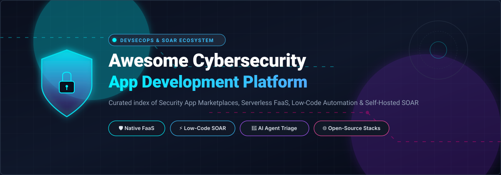
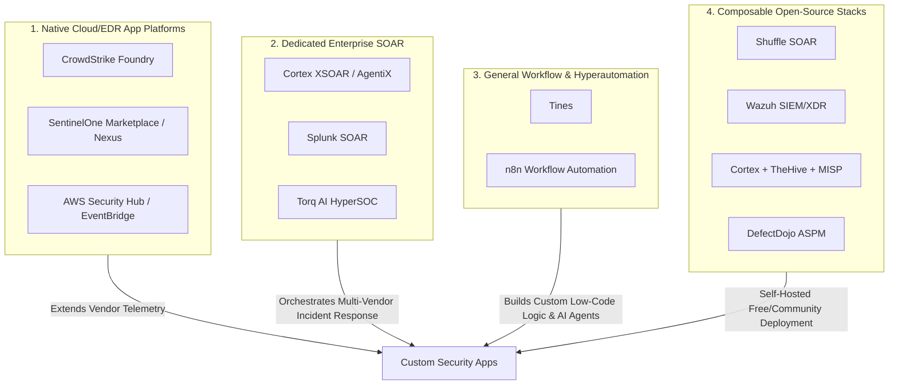

  

# 🛡️ Awesome Cybersecurity Application Development Platform 🚀

  
  
  
  
  
  

> 🌐 A curated directory of leading **Cybersecurity Application Development Platforms**, **Security App Marketplaces**, **Low-Code Automation & Hyperautomation Engines**, **Serverless Security Functions (FaaS)**, and **Self-Hosted SOAR Platforms**.

A comprehensive index covering enterprise SaaS platforms and self-hosted open-source frameworks empowering DevSecOps, SecOps, and security engineering teams to build, deploy, orchestrate, and distribute custom security workflows, detections, and applications. 🔐⚡

---

## 📑 Table of Contents

- [📊 Sector Overview & Market Dynamics](#-sector-overview--market-dynamics)
- [☁️ SaaS & Commercial Hosted Platforms](#️-saas--commercial-hosted-platforms)
- [🔓 Open-Source GitHub Projects](#-open-source-github-projects)
- [🏗️ Architecture & Platform Comparison](#️-architecture--platform-comparison)
- [🤝 How to Contribute](#-how-to-contribute)
- [💖 Support](#-support)
- [⚠️ Disclaimer](#️-disclaimer)
- [⭐ Star History](#-star-history)

---

## 📊 Sector Overview & Market Dynamics

The global Security Orchestration, Automation, and Response (SOAR) and cybersecurity automation market is estimated at **$2.01B to $2.6B in 2026** (expanding within a broader **$11.0B–$13.9B** cybersecurity automation space) at a robust compound annual growth rate (CAGR) of **14.7%–17.4%**, driven by acute alert fatigue, regulatory breach disclosure mandates, and agentic AI integration. 📈

The sector remains **moderately fragmented**: hyper-scale cloud and security titans (Microsoft, Amazon AWS, Palo Alto Networks, CrowdStrike, Cisco/Splunk) dominate centralized platform ecosystems, while specialized autonomous AI SOC disruptors (Torq, Tines) and self-hosted open-source frameworks (Shuffle, Wazuh, OpenCTI) sustain substantial innovation and capture niche enterprise demand. 🧩

---

## ☁️ SaaS & Commercial Hosted Platforms

The table below catalogs premier commercial security application development platforms and hyperautomation suites, ranked descending by corporate scale (market capitalization or latest enterprise valuation). 💼

| Platform / Vendor | Company Size (Market Cap / Valuation) | Pricing (Specific Starting Tiers) | Free Tier / Trial Limits | Core Focus & Extensibility |
| :--- | :--- | :--- | :--- | :--- |
| **[Microsoft Security Copilot Ecosystem](https://www.microsoft.com/security/copilot)** | ~$3.88 Trillion (Public Market Cap) | Provisioned Security Compute Units (SCU) at **$4.00/hour** per provisioned unit ($2,880/unit/month); partner add-ons billed separately. | **Included quota** for Microsoft 365 E5/E7 enterprise agreements; no standalone free-for-ever tier. | Security Store ecosystem allowing partner AI agents, custom plugins, and bidirectional access to Defender, Sentinel, Intune, and Entra ID data. |
| **[AWS Security Hub](https://aws.amazon.com/security-hub/)** | ~$2.65 Trillion (Amazon Public Market Cap) | **$0.0010 per finding ingestion** for the first 10k/month ($0.0007 beyond); compliance checks at **$0.0010 per check** (first 100k/account/region). | **30-Day Free Trial** per AWS account and region covering all finding ingestion and automated compliance checks (add-on GuardDuty/Inspector billed separately). | Cloud security posture management (CSPM) and central integration hub triggering automated EventBridge response flows and Lambda security functions. |
| **[Palo Alto Cortex XSOAR](https://www.paloaltonetworks.com/cortex/cortex-xsoar)** | ~$298 Billion (Public Market Cap) | MSSP entry packages starting from **~$16,600/user/year**; enterprise agreements typically start at **$50,000+/year**; Cortex AgentiX billed on metered compute units. | **No free tier**; custom sales-led proof-of-concept (POC) typically granted for **14 to 30 days** upon enterprise sales qualification. | Industry standard enterprise SOAR with extensive War Room collaboration, threat intelligence management, and thousands of playbook automation packs. |
| **[CrowdStrike Falcon Foundry](https://developer.crowdstrike.com/foundry/)** | ~$254 Billion (Public Market Cap) | Base Falcon subscription starts at **$59.99/device/year** (Falcon Go) or **$99.99/device/year** (Falcon Pro); Foundry solution tiers quoted via FalconFlex. | **1 custom Foundry application included free** with qualifying Falcon Prevent or Falcon Insight XDR enterprise entitlements; **15-day free trial** for Falcon platform. | Low-code application development platform inside Falcon console; supports custom UI cards/panels, serverless functions (Python/Go), and Fusion SOAR workflows. |
| **[Splunk SOAR](https://www.splunk.com/)** | ~$28 Billion (Acquired by Cisco) | Splunk Enterprise base ingest starts at **~$1,800–$2,000/GB/day/year**; standalone Splunk SOAR automation tiers start at **~$15,000/year** (or ~$15/monitored entity/mo on Observability). | **Free Splunk Enterprise trial for 60 days** (500 MB/day indexing limit); Splunk SOAR Community Edition permits up to **100 actions per month** permanently free. | Enterprise playbook automation, case management, and modular custom app development using Python SDKs, REST APIs, and prebuilt community integrations. |
| **[Elastic Security](https://www.elastic.co/security)** | ~$10.3 Billion (Public Market Cap) | Serverless ingest from **$0.09/GB** (Essentials) or **$0.11/GB** (Complete); storage retention at **$0.017/GB/month**; Workflows execute at **$0.0108 to $0.025/run** after free allowance. | **14-Day Free Cloud Trial** (fully featured Elastic Security deployment with no credit card required); Workflows feature provides **10,000 executions permanently free/month**. | Unified SIEM and security analytics with serverless pricing, native AI Assistant, scripted custom Workflows, and zero per-endpoint fees. |
| **[SentinelOne Singularity Marketplace](https://www.sentinelone.com/platform/singularity-marketplace/)** | ~$8.7 Billion (Public Market Cap) | Core Singularity platform begins at list price of **$69.99/endpoint/year** (Core) and **$179.99/endpoint/year** (Complete); Marketplace access is included. | **30-Day Free Trial** available upon qualification; no permanent free-for-ever tier. | Serverless FaaS framework (Nexus) executing bite-sized apps, automated bidirectionally between Singularity XDR and external threat feeds or IT tooling. |
| **[Torq](https://torq.io/)** | ~$1.2 Billion (Valuation - Series D) | Enterprise subscriptions starting at **~$30,000–$45,000/year** for base mid-market packages; comprehensive AI HyperSOC tiers scale to $100K+/year. | **No permanent free tier**; interactive guided sandbox environment and **14-day evaluation POC** provided via sales qualification. | Autonomous AI SOC and enterprise security hyperautomation platform offering 300+ prebuilt integrations, 4,000+ workflow steps, and natural language agent triage. |
| **[Tines](https://www.tines.com/)** | ~$1.125 Billion (Valuation - Series C) | Starter tier begins at **$20,000/year** (unlimited builders, up to 1M monthly events, 7-day data retention); scaling to tailored Enterprise plans. | **Forever Free Community Edition**: includes **1 builder, 3 active/live workflows**, unlimited viewers, unlimited parallel runs, unlimited integrations, and **$50 one-time AI credits**. | No-code, developer-grade security workflow orchestration system supporting flexible HTTP/REST actions, automated incident triage, and AI chat agent integration. |
| **[Rapid7 Insight Platform](https://www.rapid7.com/)** | ~$900 Million (Public Market Cap) | InsightVM begins at **$18.50/asset/year** (minimum 250 assets = $4,625/year); InsightIDR / InsightConnect SOAR median contract starts at **~$36,678/year**. | **30-Day Free Trial** with full scanning capability for up to 256 assets (InsightVM/InsightConnect); no permanent free-for-ever tier. | Vulnerability management and security automation (InsightConnect) delivering risk scoring, automated containment playbooks, and ITSM ticketing synchronization. |

---

## 🔓 Open-Source GitHub Projects

The table below catalogs premier open-source platforms for security application development, workflow automation, indicator enrichment, and adversary emulation. Repositories are ordered strictly descending by GitHub star count. 🌟

| Project / Repository | GitHub Stars | Primary License | Architecture & Key Capabilities |
| :--- | :--- | :--- | :--- |
| **[n8n](https://github.com/n8n-io/n8n)** |  | Sustainable Core Source (Fair-Code) | Fair-code workflow automation platform with native AI agent nodes, visual building, custom JavaScript/Python execution, and 400+ connectors extensively utilized in custom SecOps automation. |
| **[Trivy](https://github.com/aquasecurity/trivy)** |  | Apache-2.0 | Comprehensive security scanner and application analysis engine for containers, Kubernetes, code repositories, cloud misconfigurations, and SBOM generation. |
| **[Nuclei](https://github.com/projectdiscovery/nuclei)** |  | MIT | Fast, community-driven vulnerability scanner built on simple YAML-based DSL templates enabling automated detection, zero-day regression testing, and security app workflows. |
| **[Osquery](https://github.com/osquery/osquery)** |  | Apache-2.0 | SQL-powered operating system instrumentation, telemetry gathering, and monitoring framework exposing low-level system attributes as relational database tables. |
| **[Wazuh](https://github.com/wazuh/wazuh)** |  | GPL-2.0 | Full open-source security platform combining unified XDR and SIEM capabilities across endpoints and cloud workloads, featuring file integrity monitoring and automated incident response scripts. |
| **[Open Policy Agent (OPA)](https://github.com/open-policy-agent/opa)** |  | Apache-2.0 | CNCF Graduated, general-purpose policy engine that unifies policy enforcement across microservices, Kubernetes admission control, CI/CD pipelines, and application API authorizations. |
| **[OpenCTI](https://github.com/OpenCTI-Platform/opencti)** |  | Apache-2.0 | Unified Cyber Threat Intelligence (CTI) and knowledge management platform facilitating structured observable analysis, automated threat feed ingestion, and relationship mapping. |
| **[Falco](https://github.com/falcosecurity/falco)** |  | Apache-2.0 | Cloud-native runtime threat detection engine utilizing eBPF to detect anomalous system calls and trigger immediate automated container security containment workflows. |
| **[Zeek](https://github.com/zeek/zeek)** |  | BSD-3-Clause | Deep network analysis and behavioral monitoring framework that translates raw network traffic into structured, queryable logs and powers real-time event-driven automation scripts. |
| **[Infection Monkey](https://github.com/guardicore/monkey)** |  | GPL-3.0 | Zero-trust adversary emulation and automated penetration testing platform that safely maps internal attack surfaces and tests automated incident response capabilities. |
| **[MISP](https://github.com/MISP/MISP)** |  | GPL-3.0 | Widely adopted threat intelligence sharing platform providing open taxonomies, structured IOC curation, and automated API integration with SIEM and SOAR engines. |
| **[DefectDojo](https://github.com/DefectDojo/django-DefectDojo)** |  | BSD-3-Clause | Leading open-source vulnerability management, DevSecOps orchestration, and Application Security Posture Management (ASPM) platform with 160+ security tool integrations. |
| **[TheHive (v3/v4)](https://github.com/TheHive-Project/TheHive)** |  | AGPL-3.0 | Scalable open-source security incident response and case management platform designed for SOCs and CERTs (Note: newer v5+ releases are commercially licensed). |
| **[Elastic Detection Rules](https://github.com/elastic/detection-rules)** |  | Elastic License 2.0 | Detection rules repository for Elastic Security SIEM, providing open-source detection engineering rules, unit tests, and CI/CD validation workflows. |
| **[Shuffle](https://github.com/Shuffle/Shuffle)** |  | AGPL-3.0 | Dedicated open-source SOAR platform featuring an interactive visual workflow builder, OpenAPI generation, app ecosystem, and hybrid/on-prem security orchestration. |
| **[Cortex](https://github.com/TheHive-Project/Cortex)** |  | AGPL-3.0 | Observable analysis and active response engine allowing SOC analysts to automate indicator enrichment and active response actions via modular analyzers and responders. |
| **[Cortex XSOAR Content](https://github.com/demisto/content)** |  | MIT | The community content and integration pack repository for Cortex XSOAR, providing thousands of automations, playbooks, and incident response integrations. |

---

## 🏗️ Architecture & Platform Comparison

When architecting a custom cybersecurity application or automation pipeline, understanding the four distinct platform archetypes is essential: 🔍

1. **Native Security App Platforms (Foundry, Nexus, Security Hub):**
   - *Strengths:* Direct zero-latency access to telemetry data, native UI extensions inside central consoles, and managed serverless FaaS compute. ⚡
   - *Considerations:* Strong architectural binding to the host vendor's ecosystem. 🔒
2. **Dedicated SOAR Suites (XSOAR, Splunk SOAR, Torq):**
   - *Strengths:* Prebuilt multi-vendor playbooks, War Room case management, automated alert deduplication, and forensic audit logging. 🛡️
   - *Considerations:* Enterprise-tier annual commitments, migration lock-in. 💼
3. **Developer-Grade Workflow Automation (Tines, n8n):**
   - *Strengths:* Extremely flexible HTTP/webhook execution, rapid visual prototyping, modern AI model integrations, and generous free tiers. 🤖
   - *Considerations:* Requires implementing custom data schemas for SecOps case management. ⚙️
4. **Self-Hosted Composable Stacks (Shuffle + Wazuh + DefectDojo + Cortex):**
   - *Strengths:* Zero software licensing cost, complete on-prem and air-gapped data sovereignty, total customization. 🔓
   - *Considerations:* Requires dedicated infrastructure maintenance, container orchestration, and manual API connector upkeep. 🛠️

---

## 🤝 How to Contribute

We welcome additions, updates, and corrections from the community! 🎉

1. Fork this repository 🍴.
2. Ensure your proposed addition fits either the SaaS or Open-Source category:
   - For SaaS tools: include exact vendor pricing tiers, explicit free tier / trial terms, and corporate valuation. 📋
   - For Open-Source projects: provide the repository link, official license, architecture overview, and GitHub stars badge. 🌟
3. Follow the established markdown table format. ✨
4. Submit a Pull Request with a clear summary of your enhancements. 🚀

---

## 💖 Support

Thank you so much for exploring and using this curated resource! If you find this repository valuable:

- ⭐ **Star this repository** to help others discover it!
- 🍴 **Fork it** and contribute your favorite security platforms or automation workflows!
- 📢 **Share it** with fellow DevSecOps engineers, SOC analysts, and cybersecurity builders!
- ☕ **Buy me a coffee**: Support ongoing open-source maintenance directly on the [GitHub Sponsor Dashboard](https://github.com/sponsors/ishandutta2007)!

Every star, share, and contribution is deeply appreciated! 🙏✨

---

## ⚠️ Disclaimer

- This curated list is maintained for educational and architectural evaluation purposes and does not represent an endorsement of any vendor or project. ⚖️
- Pricing metrics, trial durations, and enterprise tiers fluctuate; always consult official vendor quotes and product catalogs before finalizing procurement. 🔍
- Organizations deploying self-hosted SOAR or automated response engines must exercise strict credential segregation and role-based access control (RBAC), as security automation platforms possess high-privilege access across operational networks. 🚨

---

##  Star History

